# Reparar a verificação e qualificar os 14 engines para o piloto

> Executar com **heropa:sdlc-implement**, fornecendo este arquivo como `Task:` único.
> Cada critério vira um check com prova referenciada pelo número. Nada em `Unresolved` é decidido silenciosamente durante a implementação.

Change-id: `2026-10-15-ecosystem-product-readiness` · From: [discovery](design.md) e [spec](spec.md) · Status: **approved** · Prioridade pedida por Daniel: **#657 → #656 → qualificação dos 14 engines**.

## Intent

Na discovery em `f98e7fa32deac836addc348e185e8788fd197627`, um registro sintético de jogo sem recibo independente permite uma decisão que promove maestria, e o verificador fonte recusa a lição l02 v4 atual. Seis claims estão stale e o inventário formal cobre seis dos quatorze engines. O fundador não tem prova para oferecer o conjunto como pronto. Não foram medidos usuários afetados ou prejuízo financeiro.

A entrega conclui os reparos existentes, comprova cada engine no uso declarado e renova as claims afetadas sem misturar progresso local, maestria e prontidão. A [discovery](design.md) é vinculante para escopo, Journey, Shape e limites; não propõe novas telas. A [matriz de execução](qualification-matrix.md) contém os comandos e casos por engine; os critérios numerados deste arquivo são a autoridade de aceite.

**34 critérios em 6 slices · 2 decisões de contrato difíceis de reverter · 3 pendências, sendo 2 `blocks` e 1 `blocks go-live`.**

Uma tarefa cobre a fonte inteira. Há ordem operacional obrigatória entre reparos e qualificação dependente, mas não surgiu evidência de outra equipe ou de necessidade de fragmentar a unidade de aceite. Os PRs existentes continuam unidades separadas de revisão. Esta é uma tarefa grande pela amplitude da prova; não exige migração de dados nem plataforma nova. Sizing segue a convenção local `intent/` e a regra de uma tarefa por fonte de `sdlc-plan`; quantidade de PRs não foi usada como medida de tamanho de tarefa.

Baseline da discovery: `f98e7fa32deac836addc348e185e8788fd197627`. Main remota observada no planejamento: **`0a2e2dbeda5e41b00642a5280e40a0d8102d1102`**. O delta contém mudanças de foco em `/escola/`, nomes acessíveis de dojoToday e registros de intent; não altera os contratos dos reparos. O checkout da discovery permanece pinado, sem trocar arquivos enquanto o grounding é feito. Antes de executar, obter a tip atual de main e registrar o SHA do candidato integrado; nenhuma prova histórica recebe um SHA novo por edição do relatório.

## Criteria

### Gate de jogos recusa promoção sem verificador — PR #657

1. Dado um aprendiz temporário em `evaluating` e evidência GATEKEEPER ou Pixel com `pass:true` e métricas autoconsistentes, quando falta recibo independente, a decisão é inelegível (`ok=false`, `passed=false`, sem receipt): zero transição, zero review e zero consumo de `evidence_ts`; o estado permanece byte a byte igual.
2. Dado recibo com digest de outro registro, caminho fora de `learner/verifier_receipts`, contexto não isolado ou bloco `verifier` embutido pelo produtor, a tentativa não promove `mastered`; cada rejeição conserva o estado e identifica a violação do vínculo existente.
3. Dada a mesma tentativa com recibo separado, confinado e digest-bound, `context_isolated=true`, PASS e scores nos thresholds configurados, o gate produz `pass_first_try`/`mastered`; após retry legítimo produz `pass_retried`, registrando a fonte do verificador no review.
4. Uma tentativa legítima `pass:false` continua elegível para resultado `fail`: o aprendiz permanece `evaluating`, `retry_count` aumenta em 1 e o retry documentado continua possível; a exigência de recibo para um pass não converte todo insucesso pedagógico em erro de integridade.
5. Um NDJSON legítimo seleciona o último registro da unidade ativa e vincula o recibo a esse registro; outras unidades não o substituem. Após commit no repositório temporário, `load_and_validate` aceita o backing. Sem registro correspondente, o CLI retorna `NOTHING TO GRADE`/exit 0 sem escrever; linha corrompida ou não objeto é recusada.
6. Um estado histórico válido com `mastered` anterior à exigência de recibo continua validando sem reescrita de reviews ou migração retroativa; não se altera `standards.py` ou flags de rubrica para contornar a correção no seam de decisão.
7. Depois de consumir uma evidência, sua repetição continua recusada pelo guard existente de timestamp/digest/identidade da tentativa, sem segundo review. `--dry-run` mantém zero escrita tanto no caso positivo quanto no negativo.

### Literacy verifica as três atividades v4 — PR #656

8. Um registro honesto l02 v4 de cada atividade `l02-a1/output_comparison`, `l02-a2/choice` e `l02-a3/sort`, com resposta aprovada pelo avaliador atual, recebe recibo `PASS`, `independent_pass:true` e `verifier_version:"1-netlify-l02-v4"`, vinculado ao digest e à identidade exatos da tentativa.
9. O verificador recompõe os checks, score e pass a partir de `answer`, conforme as regras atuais transcritas em Proof. Alterar somente `deterministicChecks`, `score` ou `pass` gera `FAIL` com o erro de divergência correspondente e `mastery_eligible:false`; uma resposta honestamente incorreta gera `FAIL` pedagógico e pode ter `errors:[]`.
10. v3 legado, identidade/tipo/skillIds incompatíveis ou `activityId` ausente, null, numérico, booleano, array ou objeto recebem recibo `FAIL`, sem coerção para uma atividade válida e sem exception. A mudança não exige reescrever recibos históricos aceitos pelo cliente agnóstico à versão.
11. Na lição real, a última evidência passante selecionada por `LessonScreen` chega a `ResultScreen` e recebe recibo válido correspondente, seja a1, a2 ou a3. O resultado continua progresso local; zero escrita de `mastered` no aprendiz canônico.
12. Com o transporte de verificação indisponível/rejeitado, a tela de resultado preserva progresso/evidência e oferece retry; após restaurar o endpoint, uma nova tentativa de verificar recebe recibo vinculado. Mock de HTTP ou fallback sozinho não encerra esse critério.
13. Se o piloto oferecer o verificador publicado, a prova registra URL/origem, deploy ID, source SHA e `verifier_version`, com positivos a1/a2/a3 e negativos de identidade/adulteração executados no endpoint real; merge ou E2E do Vite não substitui essa prova.

### Os reparos têm prova no candidato que será integrado

14. Cada PR, após sincronizar com main e incorporar os ajustes necessários, tem diff completo revisto, provas funcionais discriminantes, revisão independente e checks requeridos `success` no head/merge-ref correspondente. O #657 obtém novos resultados para os três checks cancelados; o #656 resolve proteção de testes com aceite rastreável do owner e registra produtor real antes do countersign. O corpo de cada PR passa a refletir seu escopo real, sem declarar aprovações inexistentes.
15. A integração preserva o protocolo local: atualização de `MANIFEST.md` junto das mudanças de gate/contrato, countersign de agente distinto pinado ao head final e merge somente pela porta `scripts/merge_pr.sh`, quando autorizado. Quando o diff atingir specs/`sourcePaths` de claims publicadas, o lote só fecha com re-grant emparceirado completo e lane de claims de main verde. Um avanço de main que altere a fonte coberta exige nova âncora/prova.

### Cada engine tem resultado observável no uso que oferece

16. O pacote informativo contém exatamente os 14 `engineId` de Journey, sem duplicatas, e todos os campos de Shape/Adds: `declaredUse`, `entry`, `runtime`, `sourceCommit`, `sourceFingerprint`, `observedAt`, `producerContext`, `verifierContext`, `cases`, `evidenceRefs`, `limitations`, `linkedUseCases`, `status`. Cada caso obrigatório e variante oferecida tem fonte da promessa, resultado e prova com digest; contextos de produtor/verificador são distintos. `pass` exige todos os casos obrigatórios comprovados; falha comprovada gera `blocked`, prova ausente gera `unverified`; inaplicabilidade tem justificativa com fonte.
17. `aiDevschoolMvp`: no harness oferecido e em perfil isolado, tentativa representativa → gates G1–G4 → agendamento/recomputação → card/ledger próprios funciona, incluindo negativa pedagógica/retry/retorno. Script com exit não zero repassa o erro literalmente e para, conforme a SKILL; não se faz autoreparo ou retry improvisado. O registro identifica as variantes dos 24 conceitos e plataformas cobertas; G4 usa o caminho existente de julgamentos por digest. Ausência de julgamento live não é suprida com fixture apresentado como IA real; zero promoção canônica e zero entrega a canal real.
18. `codexDojo`: dashboard lê a projeção, apresenta a próxima ação e permite copiar o prompt; a ponte OS configurada abre o destino correto e a configuração ausente mantém o comportamento documentado, sem escrita em `learner/`.
19. `codexdojo-os-prototype`: primeira entrada → escolha de trilha → missão suportada → resultado → retorno no mesmo perfil funciona, incluindo falha de host/verificação e storage limpo. O conjunto oferecido de missões/adaptadores tem cobertura explícita; listagem de catálogo ou bundle não conta como missão executada. Progresso local e ações do Hub não promovem maestria.
20. `dojoToday`: revisões, streak, unidade ativa e próxima ação correspondem à projeção; a prática inline oferecida do jogo 02 funciona e o limite somente leitura permanece observável. Sócrates offline e a configuração BYOK que for oferecida têm resultado/recovery honesto; chave não aparece nos artefatos e limpar configuração remove o dado local correspondente.
21. `literacyDojo`: o percurso standalone oferecido de IA Prática cobre suas lições/atividades, feedback, retry, desafios, reviews e retomada local; Dev segue o CTA para OS. Reload no meio da atividade respeita o reinício documentado da lição e não reconstrói respostas transitórias. As três atividades v4 e a recuperação de verificação satisfazem 8–12.
22. `miniMaxEvolutionEngine`: um ciclo supervisionado oferecido de cinco fases produz artefatos com produtor/verificador separados; interrupção → status/diagnóstico → recuperação explícita não redispara trabalho automaticamente. Somente se oferecida, a autonomia `spec → spec-done` é observada com seus controles atuais; fixture tracer ou `tick` sem execução de modelo não é prova dessa autonomia.
23. `miniTown`: entrada → exploração/dia-noite/HUD → saída/reabertura funciona no uso experimental; falha do renderer/rota segue a orientação existente de reload/saída. Não exigir persistência, lição, assessment ou maestria que o contrato exclui.
24. `minimaxDojo`: bootstrap no MiniMax Agent Team → tentativa → Prometor e Crítico em contextos separados → relatório/whiteboard/reflexão funciona, com erro/retry/retomada pelo Maestro. Teste do núcleo Python não substitui a execução da plataforma real, e o whiteboard local não vira autoridade global.
25. `openclaw`: em checkout descartável completo, preview é somente leitura; avanço simulate-grade por checklist e bloqueio por artefato/gate ausente correspondem ao pipeline observado, com retomada dentro do contrato. A CLI deriva a raiz do módulo, portanto zero execução de avanço na árvore compartilhada e zero alegação de IA/maestria empírica.
26. `pixelDojo`: cada lab oferecido do PixelQuest tem entrada, interação principal, retry/retorno aplicável e evidência NDJSON recuperável para verificador independente; o jogo mantém append-only e não escreve estado canônico. Seeds de brainstorm e a pasta reservada `games/` não entram como jogos lançados.
27. `school-entry`: catálogo inicial desabilitado → indisponibilidade explícita; operador autenticado configura um destino confiável → checagem inicial → até 3 recomendações elegíveis → lançamento. Anônimo não libera engines. Chave ausente/erro/timeout segue o fallback existente; falha de storage não aparenta liberação bem-sucedida. Checker mantém restrições de rede e não concede prontidão ao destino.
28. `sdlc-quest`: os modos oferecidos de campanha/workshop/lab e idiomas funcionam por HTTP e no standalone documentado, com salvar/retomar e export/import com preview. Mudança de origem e perda de aprovações do lab ao importar são explicadas. `set_content` com storage simulado não é prova de HTTP ou `file://` real.
29. `voxelDojo`: os jogos/variantes oferecidos no catálogo têm loop didático L1–L4, recuperação de renderer quando suportada e evidência bruta entregável ao verificador; localStorage sozinho não é prova. Cada jogo declarado recebe resultado próprio; um smoke do jogo 10 não aprova os demais.
30. `zai-duolingo-like`: as duas entradas de onboarding e o currículo local oferecido têm perfil → lição → progresso → prática/revisão e recuperação documentada, usando DBs de teste isolados. Chat configurado e provider ausente/falhando têm resultados honestos; identidade/progresso continuam próprios. Os modos Next e Bun oferecidos são identificados separadamente, sem reciclar servidor de outra instância.

### Claims correspondem à fonte e à observação independente

31. Para os seis casos stale da discovery e quaisquer adicionais invalidados pelo candidato final, há novos fatos e assessments independentes aplicáveis à fonte oferecida; `check --require-current` retorna 0. Assessments e resultados históricos permanecem auditáveis, sem reescrever suas datas/digests para fazê-los parecer novos.
32. O relatório dos 14 engines e `engine-qualification.json` permanecem informativos: nenhum `ReadinessTier` é concedido por eles. `aggregate --observations` recebe somente bundles no esquema existente (`observerContext:"independent-readiness-observer"`), nunca o JSON informativo de qualificação; não ocorre erro de shape nem inclusão de casos alheios que rebaixe claims por ausência de observação.
33. A árvore integrada prevista e o push-run pós-merge de main passam na lane de claims. `assess`/re-grant promovido inclui observação independente; proposta `pending-observation`/exit 3 e CI de produtor não encerram o lote. Se main avançar sob o fingerprint, a prova é renovada conforme o runbook single-writer.

### A oferta tem conclusão fiel à evidência

34. O relatório final só afirma prontidão do conjunto quando há 14/14 `pass`, zero bloqueio crítico/alto aberto no escopo, claims correntes e provas dos ambientes efetivamente oferecidos; qualquer `blocked`/`unverified` mantém a conclusão global pendente. O resultado observado é apresentado a Daniel para aceite do piloto, separado da aprovação de código/merge.

## States

O vocabulário existente do aprendiz é preservado; muda a admissão do pass de jogo, não os nomes de estado.

```mermaid
stateDiagram-v2
    evaluating --> evaluating: sem recibo válido; zero escrita (1, 2)
    evaluating --> evaluating: fail legítimo, retry_count + 1 (4; existing)
    evaluating --> mastered: PASS independente vinculado (3)
    mastered --> mastered: histórico anterior continua válido (6; existing)
```



## Out of scope

- Novas jornadas, autenticação global, sincronização entre MVP/Zai/aprendiz, nova autoridade de readiness, autonomia adicional do MME ou redesign não sustentado por falha observada.
- Tornar todo engine um destino web público ou liberar os 13 destinos de `school-entry` indiscriminadamente.
- Aplicar o defeito do RC #662 à main sem reproduzi-lo no candidato que o incorporar.
- Corrigir incidentes novos encontrados durante a qualificação sem intent/plano próprios; registrá-los e manter a dependência aberta.
- Publicar PR/review/countersign, instalar cron em perfil real, efetuar deploy ou merge como parte desta atividade de planejamento. Essas operações aparecem como trabalho futuro condicionado ao escopo/autorização vigente na execução.

## Observable

| Surface | Decision | Landing |
|---|---|---|
| `ResultScreen` de Literacy | vazio/loading | existing — estado anterior à submissão e transporte em `ResultScreen.tsx`; não há tela nova. |
| `ResultScreen` de Literacy | erro/retry | 12; preserva evidência e progresso. |
| `ResultScreen` de Literacy | resultado, ordenação/densidade | 11; existing — layout/copy atuais, sem redesign. |
| Apps dos 14 engines | primeira entrada/vazio | 17–30 e casos explícitos na matriz. |
| Apps dos 14 engines | loading/erro/retorno | 17–30; não se inventam estados em ferramenta somente leitura/exploratória. |
| Admin de `school-entry` | não autorizado | 27; existing — autenticação local de operador. |
| Import de SDLC Quest | confirmação destrutiva | 28; existing — preview antes de substituir estado; somente perfil de teste. |
| Demais telas | ação destrutiva | n/a — nenhum novo controle destrutivo é adicionado. |
| `POST /.netlify/functions/literacy-verify` | payload, versão e resultado | 8–10 e Surface; identidade/digest continuam vinculantes. |
| Mesmo endpoint | erros/códigos, caller, limite | existing — POST público; teto de 65.536 bytes, 405/413, JSON de recibo e `cache-control:no-store`. Nenhum rate limit/autorização novo faz parte do reparo. |
| Provider/chat existentes | indisponibilidade/configuração | 20, 27, 30; configuração real e limites registrados. Não adicionar timeout novo ao HttpVerificationClient como efeito colateral. |
| CLI do gate | saída, flags/defaults/exits | 1–7; existing — flags/saídas do CLI atual, `--dry-run` readonly e `NOTHING TO GRADE`/0. |
| CLI de readiness | saída, flags/defaults/exits/falha parcial | 31–33; existing — `check` 0/1, `regrant` 0 escrito/1 inválido/2 uso ou branch guard/3 observação pendente. |
| Agendamento do MVP/runner MME | flags/defaults e efeito operacional | 17, 22; existing — instalador cria cron, `tick` só solicita trabalho; perfis descartáveis e Unresolved 2. |
| Relatório/JSON de qualificação | estrutura, tom, profundidade e próxima ação | 16, 34; fatos e limites por engine, bloqueios e próximo passo; não concede tier. |
| Coleção de engines/casos | agrupamento, nomes, ordem, duplicatas, exceções | 16, 32; exatamente 14 IDs, casos por promessa/variante, ausências explícitas; `shared` é dependência. |

## Swept

- validation: 1–3, 5, 8–10 e 16 — binding de recibo/identidade e completude dos registros.
- failure modes: 4–5, 12, 17–30 — erro pedagógico, parsing, transporte, entrada e recovery por engine.
- idempotency and retry: 4, 7 e 12; existing — guard de replay do gate; re-grant não duplica decisão histórica para contornar freshness.
- authorization: 2, 14–15, 27; existing — confinamento, proteção de testes, operador local e porta de merge; Unresolved 1 para a exceção auditável.
- concurrency and ordering: 15, 33; existing — lote single-writer e revalidação da fonte antes de promover; reserva de portas/servidores e uma gravação por checkout na matriz. Não criar um lock distribuído novo.
- data lifecycle: 6, 16–17, 25, 28, 30–31 — histórico preservado, perfis/DBs temporários e provas retidas com digest; não há backfill.
- external-dependency failure: 12–13, 17, 20, 22, 24, 27, 30; Unresolved 2–3 para acesso/harness/deploy real. Fixture/fallback não prova serviço live.
- state transitions: 1, 3–4, 6–7 e 31–34 — admissão do gate, retry e autoridade de claim, sem fundir progresso local com maestria.
- observability: 16, 31–34 — SHA/fingerprint, ambiente, horário, contexts, comandos/exits e artefatos/digests; não se propõe SLO estatístico sem instrumentação.

## Impact

| Front | What changes |
|---|---|
| domain | `mastered` mantém o significado canônico; novas promoções de jogos passam pela exigência de recibo no seam de decisão. Adaptadores de gate, Pixel e substrate dependem disso. |
| domain | `completed` local de Literacy continua local; recibo l02 v4 valida atividade/tentativa, sem conceder a lição inteira ou maestria canônica. |
| domain | `ReadinessTier` permanece concedido pelos assessments existentes; `status` de qualificação é evidência informativa, sem novo grant. |
| stored data | Nada a migrar/backfill. Preservar `learning_state.yaml`, units log, receipts e decisões antigas; acrescentar somente novas provas/assessments autorizados. |
| interfaces | Verificador fixo muda v3→v4 por atividade; cliente de receipt mantém digest/identidade e compatibilidade histórica. Bridge hospedada corpus-driven é outro contrato. |
| operations | Reexecutar checks no candidato atual; pode ser preciso resolver proteção de testes/proveniência e produzir re-grant emparceirado. Deploy do staging compartilhado afeta Literacy e OS. |
| verification | Cobertura inclui variantes oferecidas, não somente gates de produtor. OpenClaw/MME/MVP exigem isolamento além de um diretório temporário parcial. |

## Decided

Somente os contratos com consumidores/histórico persistido ficam aqui; nomes de pastas, formato interno de helpers e divisão de commits permanecem decisões reversíveis do executor.

| Decision | Shape | Alternative rejected |
|---|---|---|
| Nova promoção canônica de jogo | Pass de rubric game exige recibo separado confinado em `learner/verifier_receipts`, digest-bound e `context_isolated:true`, aceito no seam canônico; histórico válido anterior não é re-adjudicado. | Promover por `pass`/métricas do produtor contradiz a regra canônica; invalidar todo o histórico excede o reparo e altera dados já consumidos. |
| Contrato público de l02 | `schemaVersion:1`, `source:"literacydojo"`, `lessonId:"l02"`, `lessonVersion:4`, `skillIds:["entender","avaliar"]`, tipo/ID da atividade correspondentes; recibo `1-netlify-l02-v4`, digest e identidade exatos, `producer_writes_mastered:false`. | Forçar o produtor a v3 ou aceitar somente a3 rompe o conteúdo e a seleção atual da última evidência passante; promover a lição inteira por um receipt de atividade excede o contrato. |

## Surface

| Route | In | Out | Status | Criteria |
|---|---|---|---|---|
| `POST /.netlify/functions/literacy-verify` | Envelope v4 acima, `attemptId`, `activityId`, `activityType`, `answer`, `deterministicChecks`, `score`, `pass`, `verifierRequired:true` | Recibo: `verdict`, `independent_pass`, `mastery_eligible`, `source`, `verifier_version`, `verified_at`, digest/identidade, `errors`, `producer_writes_mastered:false`, `max_producer_claim:"completed"` | existing — 200 com recibo PASS/FAIL; 413 corpo >65.536 bytes; 405 método ≠POST/`Allow: POST`; JSON inválido → 200/recibo FAIL | 8–13 |
| CLI de gate existente | Evidência e recibo conforme os argumentos atuais; `--dry-run` quando selecionado | Decisão elegível/inelegível; `NOTHING TO GRADE` quando não há registro da unidade | existing — 0 para NOTHING TO GRADE; demais saídas existentes preservadas | 1–7 |

## Sources

- [design.md](design.md) — **binding** para Journey, Success, Boundary, Shape e Decisions. Não há desenho novo de tela; interfaces e copy atuais permanecem salvo falha observada que gere intent próprio.
- Pedido de Daniel nesta conversa, 2026-10-15: “Use o sdlc-plan para transformar essa discovery em um plano executável, priorizando os reparos dos PRs #657 e #656 e depois a qualificação dos 14 engines.” Autoriza produzir este plano; não registra aceite para executar todos os passos ou publicar por ele.
- [Evidência da discovery](evidence/manifest.json) e [snapshot do planejamento](planning-evidence.json) — diagnóstico histórico versus main/PRs observados nesta rodada. Os scripts de probe históricos não são reatribuídos a um SHA corrigido.
- [PR #657](https://github.com/dandpb/aidevschool/pull/657) head `817b9872b2b966314794540472860a6287c4737c`; [PR #656](https://github.com/dandpb/aidevschool/pull/656) head `b29631ee366954803d59691b646c10f0779082ce` — diffs completos usados para grounding, sem aprovação funcional ou execução nesta rodada.
- [canonical_gate.py](../../learner/gate/canonical_gate.py), [verifier_receipt.py](../../learner/gate/verifier_receipt.py), [evidence_io.py](../../learner/gate/evidence_io.py), [substrate/gate.py](../../learner/substrate/gate.py) — seam de decisão, binding, parsing, histórico e transições.
- [Verificador Literacy](../../learner/gate/netlify-functions/literacy-verify.mjs), [lição canônica](../../curriculum/ai-literacy/modules/01-ai-sem-misterio/l02-ia-nao-e-fonte-de-verdade.yaml), [evaluation.ts](../../engines/literacyDojo/src/domain/evaluation.ts), [verification.ts](../../engines/literacyDojo/src/domain/verification.ts) — valores e interfaces preservados.
- [REGRANT-RUNBOOK](../../docs/product-readiness/REGRANT-RUNBOOK.md), [CLI](../../docs/product-readiness/tools/cli.py), [observations.py](../../docs/product-readiness/tools/observations.py), [ci.yml](../../.github/workflows/ci.yml) — observação, freshness, merge-ref e autoridade de grant.
- [SDLC](../../docs/sdlc/README.md), [Intent home](../README.md), [REVIEW](../../REVIEW.md), [matriz](qualification-matrix.md) — convenções, fontes por engine e comandos para o executor.

## Unresolved

| # | Kind | Question | Until answered |
|---|---|---|---|
| 1 | blocks | O aceite do owner para editar os testes existentes está registrado, resolvível e cobre o diff real de cada reparo? | Bloqueia a exceção de teste e o encerramento de 14–15, não o planejamento. Recuperar o aceite já citado nos PRs; se ausente/inadequado, obter aceite específico antes do override/trailer. Nunca forjar aprovação a partir do pedido de plano. |
| 2 | blocks | Os harnesses reais e perfis isolados necessários a MVP, MiniMax Team e MME estão utilizáveis para os casos oferecidos? | Bloqueia `pass` em 17/22/24 até o spike produzir prova. Há binários Claude, Hermes e Bun no PATH; OpenClaw externo não foi encontrado. Isso não prova login, autorização, sandbox ou execução live. Preflight verifica perfis existentes sem criar cron/entrega real; ausente → `unverified` com pré-requisito, sem implementar integração nova. |
| 3 | blocks go-live | Qual deploy ID/source SHA está realmente servindo o endpoint e os destinos oferecidos no piloto? | 13 e a afirmação remota de 34 aguardam prova atribuível. Usar as rotas/targets já declarados, registrar configuração e observar o deploy real; não tratar source/merge/URL existente como prova de publicação. |

## Files that change

Alvos concretos previstos; `sdlc-implement` confirma o diff atual e registra placement reversível antes de editar.

- Reutilizar #657: `learner/gate/canonical_gate.py`, `learner/gate/evidence_io.py`, `learner/gate/tests/test_gate.py`, `learner/gate/tests/test_gate_multirecord_receipt_binding.py` (novo no PR), `scripts/python_complexity_baseline.txt`.
- Reutilizar #656: `learner/gate/netlify-functions/literacy-verify.mjs`, `learner/gate/tests/literacy_verify_netlify.test.mjs`, `learner/gate/tests/literacy_verify_identity.test.mjs` (novo no PR), `learner/gate/netlify-functions/README.md`, `learner/gate/AGENTS.md`.
- `engines/codexDojo/ecosystem/MANIFEST.md` junto do reparo/contrato que o exigir; não atualizar claim de produto ao apenas escrever este plano.
- Novos registros informativos previstos por Shape: `docs/product-readiness/assessments/2026-10-15-ecosystem-beta-readiness.md` e `docs/product-readiness/evidence/observations/2026-10-15-ecosystem-beta-readiness/engine-qualification.json`.
- Novas provas/scripts de observação e assessments independentes; `docs/product-readiness/evidence/results.ndjson` e projeções geradas apenas pelo fluxo existente. Bundles de grant ficam em subdiretório dedicado para não misturar o JSON informativo com `--observations`.
- Manuais/instruções dos engines somente quando a observação demonstrar contradição; novos defeitos exigem intent próprio antes de código adicional. Não alterar o aprendiz real, bases locais reais ou output gerado à mão.

## Order of work

| Ordem | Trabalho e responsável funcional | Prova de saída | Dependência |
|---|---|---|---|
| 0 | Executor registra task única, tip de main, heads/diffs e autorizações; prepara checkout/venv/perfis privados. | Snapshot e preflight sem escrita no aprendiz real. | Antes de executar código ou testes que gravam estado. |
| 1 | Produtor do gate conclui #657; verificador distinto examina o candidato. | 1–7 e checks de 14–15 aplicáveis; pacote de prova no head atual. | Unresolved 1 para edição protegida; cancelamento de check não é bug de código presumido. |
| 2 | Produtor do verificador conclui #656 sobre a main/candidato acordado; verificador distinto examina integração/cliente. | 8–12 e 14–15; 13 é prova remota condicionada ao deploy. | Reutilizar a correção existente; resolver proveniência real e proteção de testes. |
| 3 | Coordenador de qualificação congela os 14 contratos, variantes, casos, responsáveis e pré-requisitos. | 16 e matriz atualizada com as fontes do candidato. | Os dois reparos funcionais estão comprovados; leitura preparatória pode acontecer antes, sem declarar qualificação. |
| 4 | Produtores de runtime e observadores distintos executam a matriz; spike delimitado para MVP/MiniMax/MME. | 17–30 com outputs, capturas e prova independente. | Checkouts/DBs/perfis/portas privados; Unresolved 2 onde aplicável. |
| 5 | Assessor independente renova as claims afetadas e verifica a integração final. | 31–33. | Fonte estabilizada e observações completas; re-grant emparceirado exigido pelo lote é antecipado a esta etapa quando 15 o exigir. |
| 6 | Verificador final consolida os resultados; Daniel observa e decide o aceite do piloto. | 34 e fechamento de cada warning com prova nova, ou pendência explícita. | 14/14 pass e pré-requisitos remotos satisfeitos para a conclusão global. |

As execuções por engine podem ser paralelas depois de 1–3, com checkouts e portas próprios. Commits/assessments/integração que afetam a mesma fonte são serializados; não compartilhar uma árvore mutável entre execuções. Uma tarefa pode produzir vários PRs revisáveis. Não há autorização de publicação/merge embutida nesta tabela.

## Risks

- Principal risco: aplicar exigência de recibo retroativamente ou perder binding de NDJSON. Provar negativos e positivos em raiz temporária resolvida, commit temporário/reload e histórico antigo antes de integrar #657.
- Atualizar só a3, aceitar coerção de `activityId` ou alterar scoring incidentalmente deixa o contrato v4 inconsistente. Provar as três atividades e os negativos no mesmo candidato de #656.
- Checks antigos/cancelados, mock HTTP ou build preview não identificam o endpoint servido. Registrar cada camada e manter 13/34 pendentes até prova real.
- Instalador do MVP, avanço OpenClaw/MME, DBs Zai, imports e prebuild do substrate podem gravar estado. Usar cópia completa privada, conferir symlinks resolvidos e digest do estado real antes/depois; não usar `--root` inexistente em OpenClaw.
- Qualificação datada pode ficar stale durante merges concorrentes. Âncora por conteúdo, lote single-writer e push-run de main são os mecanismos existentes; não relaxar gates nem reescrever hashes.
- Não escolhidos: rewrite paralelo dos PRs, plataforma nova de readiness, amostra de um jogo para todo catálogo, cinco fases autônomas do MME ou liberar destino incompatível desativando o checker.

## Proof

**Nenhum comando funcional desta seção foi executado pelo planejamento.** Rodar no candidato privado, com dependências instaladas e `python`/`python3` ligados ao venv do repositório (`python -m pip install -e ".[dev]"`). Registrar cwd, argv, SHA/fingerprint, ambiente, exit code e artefatos. Comandos que escrevem projeções/estado só rodam na cópia privada; revisar seu diff antes de promover qualquer resultado.

Gate #657:

```bash
rtk proxy python -m pytest learner/gate/tests/test_gate.py learner/gate/tests/test_gate_multirecord_receipt_binding.py -q
rtk proxy python -m pytest learner/substrate/tests learner/gate/tests learner/tests learner/analytics_events/tests curriculum/_shared/tests curriculum/ai-literacy/tools/tests engines/test_engine_contracts.py -q
rtk proxy python3 scripts/check_python_complexity.py --self-test
rtk proxy python3 scripts/check_python_complexity.py --max 8 --baseline scripts/python_complexity_baseline.txt learner engines/minimaxDojo engines/openclaw engines/miniMaxEvolutionEngine engines/aiDevschoolMvp
```

Esperado: exit 0 e provas de 1–7; o novo teste multirregistro só existe depois de incorporar o PR. Reproduzir o contraexemplo da discovery com guarda explicitamente adaptada ao SHA do candidato, sem mudar expectativa para fazer o teste passar.

Literacy #656:

```bash
rtk proxy node --test learner/gate/tests/literacy_verify_netlify.test.mjs learner/gate/tests/literacy_verify_identity.test.mjs
rtk proxy bash scripts/integration/cross-engine.sh contracts
rtk proxy python3 curriculum/ai-literacy/tools/validate.py
```

Em `engines/literacyDojo`, executar a sequência da matriz: geração → lint → testes → build → E2E. Esperado: exit 0, prova de 8–12 e negativo por adulteração; teste de identidade novo só existe no candidato. Para o endpoint publicado, obter a prova adicional de 13.

Valores do contrato atual a preservar: a1 correta `out-b` com `c-fontes,c-limites`, sem extras; score `round2((2*better + fontes + limites + semExtras)/5)` e checks obrigatórios. a2 correta `opt-verifica-na-fonte`, três checks, threshold `0.75`. a3 ordem `fluxo-resposta, fluxo-afirmacoes, fluxo-fonte, fluxo-conferencia, fluxo-uso`, score por cinco posições e threshold `0.75` (4/5 passa, 3/5 falha, conforme o avaliador atual). Envelope e `skillIds` estão em Decided. Não introduzir uma nova política de comprimento da resposta como efeito colateral.

Qualificação: executar os comandos e observações de [qualification-matrix.md](qualification-matrix.md). `status:"pass"` requer os casos, não apenas exit 0 do producer. Registrar as provas visuais positivas; config que captura só falha não basta para observação semântica.

Claims: o assessor filtra os producer reports ao conjunto revalidado, copia somente esse conjunto para `.scratch/product-readiness-20261015/claims-producers` e retém os bundles canônicos completos em `docs/product-readiness/evidence/observations/2026-10-15-ecosystem-beta-readiness/claims`. Não há bundle fictício para engine fora do inventário. Os comandos abaixo usam defaults existentes de assessment ID/datas; antes de promover, conferir a identidade calculada e manter assessments imutáveis. Reexecução que exija novo ID escolhe um ID único conforme o runbook e o registra, sem sobrescrever decisão antiga.

```bash
rtk proxy python3 docs/product-readiness/tools/cli.py aggregate --reports .scratch/product-readiness-20261015/claims-producers --observations docs/product-readiness/evidence/observations/2026-10-15-ecosystem-beta-readiness/claims --output .scratch/product-readiness-20261015/claims-candidate.json
rtk proxy python3 docs/product-readiness/tools/cli.py assess --input .scratch/product-readiness-20261015/claims-candidate.json --dry-run
rtk proxy python3 docs/product-readiness/tools/cli.py assess --input .scratch/product-readiness-20261015/claims-candidate.json
rtk proxy python3 docs/product-readiness/tools/cli.py check --require-current
rtk proxy python3 -m pytest docs/product-readiness/tests -q
```

Esperado no encerramento: todos exit 0, assessments independentes, merge-ref e main push lane verdes. O `assess` com escrita é feito pelo assessor independente após inspecionar o dry-run, nunca pelo produtor para se conceder tier; o dry-run sozinho não promove. Não passar a pasta contendo `engine-qualification.json` como bundle canônico. No estado inicial da discovery, `check --require-current` falha por seis stales: isso é diagnóstico aberto, não resultado aprovado.

## Verification split

- Produtor do reparo não emite seu próprio veredito: após o último diff/commit, verificador em contexto fresco compara o snapshot com este `Task:` e com a spec, executa negativos/positivos e registra PASS/FAIL por critério.
- Produtor de runtime prepara execução e artefatos. Observador independente verifica o que foi servido, os casos e seus limites; quando a verificação semântica de capturas exigir TypeSafe/Jev pela regra vigente, ela ocorre nesse contexto separado. Falta de acesso/prova mantém o caso não verificado.
- Assessor independente concede tiers somente no fluxo existente e contra fonte identificada; verificador final confere 14 resultados e autoridade de claims. Countersign de PR é separado do aceite de piloto por Daniel.
- Antes de qualquer commit/publicação futura, cumprir REVIEW/gates aplicáveis no snapshot. As evidências de planejamento verificam apenas a consistência do plano; não resolvem `SDLC-READY-001` a `004`.

> Aceite de execução local: Daniel invocou explicitamente `heropa:sdlc-implement` para este plano nesta conversa. Exceção delimitada do teste #656: [registro humano](owner-approval-pr656.json). Publicação, push, deploy e merge permanecem ações separadas.
